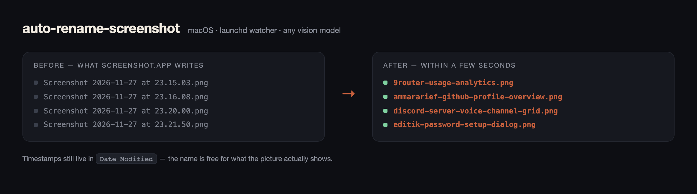
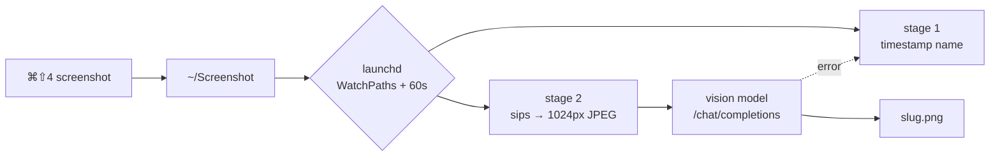

<div align="center">

# auto-rename-screenshot

**Screenshots that name themselves.** macOS writes `Screenshot 2026-11-27 at 23.16.08.png`; a few seconds later the file is called `9router-usage-analytics.png` — because a vision model looked at it.

[](LICENSE)
[](https://www.apple.com/macos/)
[](#how-it-works)
[](#why-not-shortcuts)



</div>

## What it does

Two stages, both automatic:

| Stage | When | Result |
|---|---|---|
| 1. Sortable name | immediately | `2026-11-27_23.16.08.png` |
| 2. Descriptive name | a few seconds later | `9router-usage-analytics.png` |

The model reads the text that is actually on screen — window title, page heading, product name, sidebar — so names match the product instead of a guess (`9router`, not `brouwer-go`). Generic words like `screenshot`, `interface`, `desktop` are filtered out.

Failures keep the timestamp name. Nothing is described twice: processed files carry the `com.ammar.enriched` extended attribute.

## Why not Shortcuts

The `Use Model` action in Shortcuts only accepts **text** on the current on-device model, so asking it to describe an image fails with *"The model cannot provide a response for this request"*. macOS Shortcuts also has no folder-change trigger. A launchd agent handles both, and works with any OpenAI-compatible endpoint rather than one vendor.

## Requirements

- macOS (tested on 26.x, Apple silicon)
- `bash`, `sips`, `python3`, `curl` — all ship with macOS
- A vision-capable model on an OpenAI-compatible `/chat/completions` endpoint

## Install

```bash
git clone https://github.com/AmmarArief/auto-rename-screenshot
cd auto-rename-screenshot
./install.sh                 # watches ~/Screenshot
# or: ./install.sh ~/Desktop
```

Fill in your endpoint and model:

```bash
# ~/.config/screenshot-rename.env
API_BASE=https://your-endpoint/v1
MODEL=your-vision-model
API_KEY=sk-...                                   # or keep it in Keychain:
# API_KEY_CMD="security find-generic-password -s my-service -a my-account -w"
```

Without `API_BASE` and `MODEL` the script still does stage 1 and skips the model.

Make macOS save screenshots into that folder:

```bash
mkdir -p ~/Screenshot
defaults write com.apple.screencapture location ~/Screenshot
killall SystemUIServer
```

## How it works



- `launchd` fires on folder changes and every 60 s as a fallback.
- Only screenshots newer than 15 minutes are described; older files are untouched (`ENRICH_MAX_AGE`).
- A PID-checked lock directory prevents overlapping runs, and a crashed run no longer blocks the watcher.
- The image is downscaled before upload: ~120 KB instead of several MB.

## Verify

```bash
tail -f ~/Library/Logs/screenshot-rename.log
```

```
renamed: Screenshot 2026-11-27 at 23.20.00.png -> 2026-11-27_23.20.00.png
enriched: discord-server-voice-connected.png
```

## Files

| Path | Purpose |
|---|---|
| `rename.sh` | the renamer, installed to `~/bin/screenshot-rename.sh` |
| `launchd/screenshot-rename.plist` | agent template, filled in by `install.sh` |
| `install.sh` | installs script, agent, and a config stub |
| `docs/demo.png` | the before/after image above |

## Tuning

| Want | Change |
|---|---|
| More accurate names | raise `sips -Z 1024` in `rename.sh` |
| Faster, cheaper names | lower it, or use a smaller model |
| Describe older files too | raise `ENRICH_MAX_AGE` |
| Different naming style | edit the prompt inside `rename.sh` |

## Uninstall

```bash
launchctl bootout "gui/$(id -u)/com.$(id -un).screenshot-rename"
rm ~/Library/LaunchAgents/com.$(id -un).screenshot-rename.plist \
   ~/bin/screenshot-rename.sh ~/.config/screenshot-rename.env
```

## License

MIT — see [LICENSE](LICENSE).
